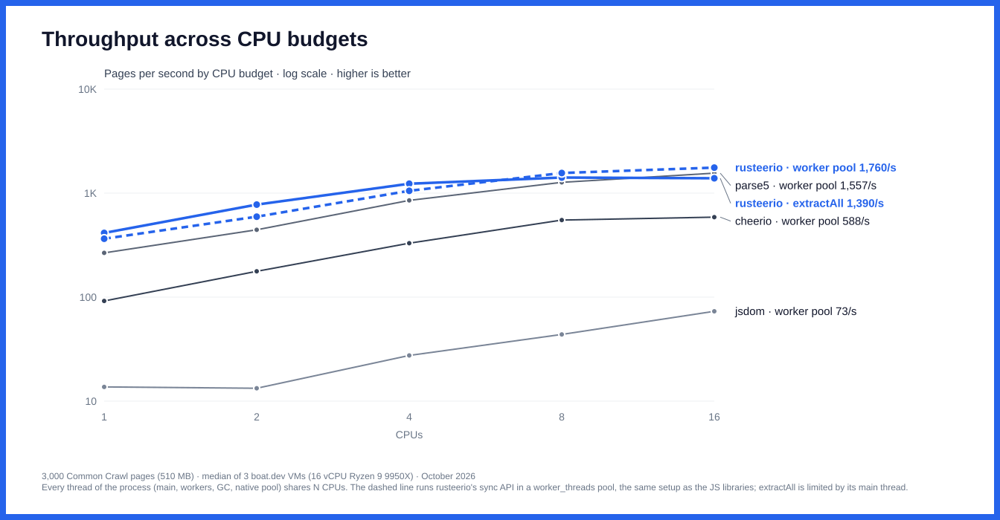
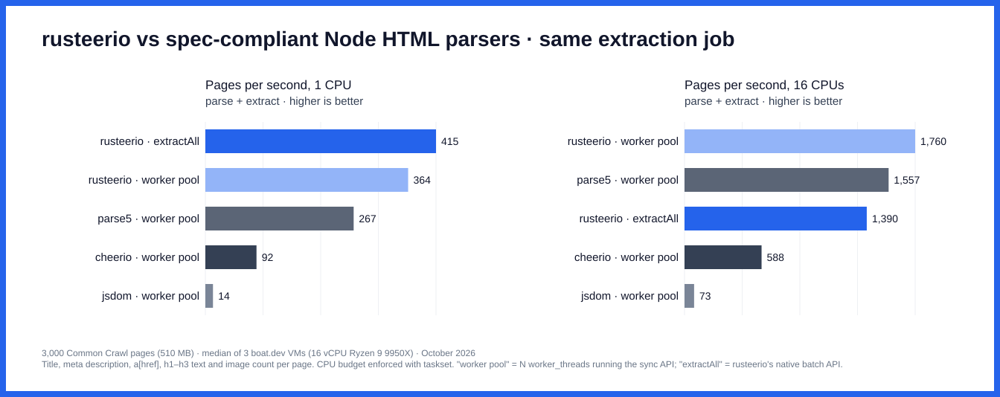
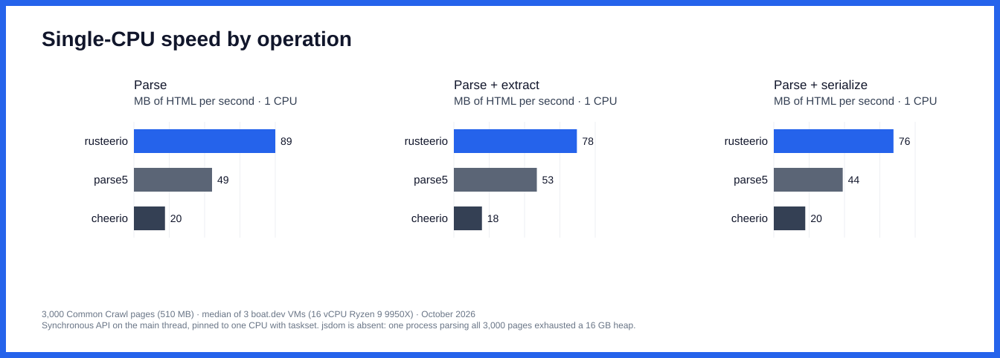
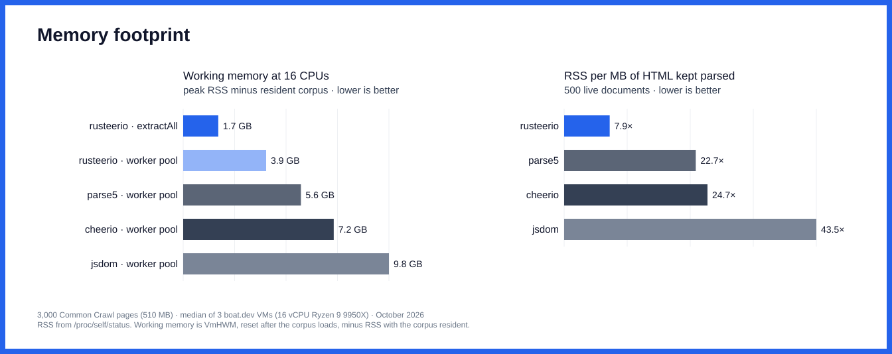
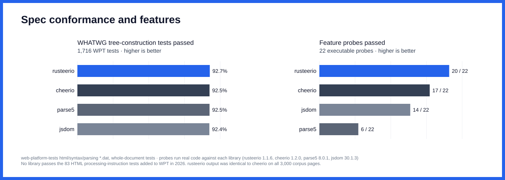
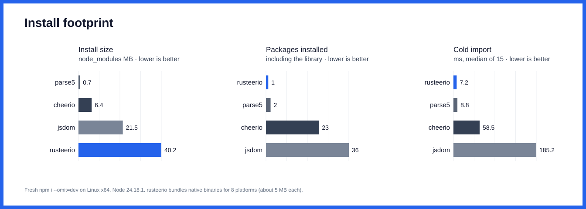

# rusteerio and other Node.js HTML libraries

Compared: **rusteerio 1.1.6**, cheerio 1.2.0, parse5 8.0.1 and jsdom 30.1.3, measured in October 2026. Only parsers that build a WHATWG-compliant tree are included. htmlparser2 12.0.0 (0.5% of WPT parsing tests) and node-html-parser 9.0.4 (0.1%) were measured but are excluded.

## Throughput across CPU budgets



3,000 pages from 3,000 different hosts in Common Crawl CC-MAIN-2026-39 (510 MB of HTML; median page 104 KB, p90 391 KB). Every library ran the same job on every page: parse, then extract the title, meta description, `a[href]` values, h1–h3 text and image count. Pages per second, median of 3 VMs:

| Library | 1 CPU | 2 CPUs | 4 CPUs | 8 CPUs | 16 CPUs | 1→16 CPUs |
| --- | ---: | ---: | ---: | ---: | ---: | ---: |
| **rusteerio** · extractAll | **415** | **776** | **1,232** | **1,413** | **1,390** | **3.4×** |
| **rusteerio** · worker pool | **364** | **594** | **1,053** | **1,562** | **1,760** | **4.8×** |
| cheerio · worker pool | 92 | 177 | 330 | 551 | 588 | 6.4× |
| jsdom · worker pool | 14 | 13 | 28 | 44 | 73 | 5.3× |
| parse5 · worker pool | 267 | 444 | 852 | 1,270 | 1,557 | 5.8× |

rusteerio's throughput rose 3.4× from 1 to 16 CPUs and stopped improving at about 8. Beyond that point the JavaScript main thread, which copies input strings into Rust and decodes results back out, was the limit: at 16 CPUs the process kept only 5.6 cores busy. Splitting the input differently (one call with every page, or 32 or 128 pages per call) changed memory use, not this ceiling.



<details>
<summary>Per-VM medians and CPU utilisation</summary>

Pages per second on each of the 3 VMs:

| Library | 1 CPU | 2 CPUs | 4 CPUs | 8 CPUs | 16 CPUs |
| --- | --- | --- | --- | --- | --- |
| **rusteerio** · extractAll | 435 / 415 / 255 | 825 / 722 / 776 | 1,301 / 1,232 / 982 | 1,225 / 1,413 / 1,473 | 1,390 / 1,403 / 1,154 |
| **rusteerio** · worker pool | 364 / 393 / 364 | 590 / 594 / 649 | 754 / 1,053 / 1,103 | 1,161 / 1,748 / 1,562 | 1,834 / 1,760 / 1,698 |
| cheerio · worker pool | 101 / 92 / 79 | 191 / 177 / 161 | 327 / 330 / 338 | 594 / 551 / 394 | 588 / 501 / 657 |
| jsdom · worker pool | 15 / 14 / 11 | 21 / 13 / 12 | 27 / 32 / 28 | 42 / 52 / 44 | 73 / 73 / 76 |
| parse5 · worker pool | 273 / 267 / 181 | 444 / 413 / 451 | 862 / 542 / 852 | 1,270 / 1,106 / 1,505 | 1,713 / 1,285 / 1,557 |

Average cores busy (process CPU time ÷ wall time):

| Library | 1 CPU | 2 CPUs | 4 CPUs | 8 CPUs | 16 CPUs |
| --- | ---: | ---: | ---: | ---: | ---: |
| **rusteerio** · extractAll | 1.0 | 2.0 | 3.3 | 4.5 | 5.6 |
| **rusteerio** · worker pool | 1.0 | 2.0 | 3.9 | 7.8 | 14.7 |
| cheerio · worker pool | 1.0 | 2.0 | 4.0 | 8.0 | 15.7 |
| jsdom · worker pool | 1.0 | 2.0 | 4.0 | 7.9 | 15.8 |
| parse5 · worker pool | 1.0 | 2.0 | 3.9 | 7.8 | 15.6 |

</details>

## Single-CPU speed by operation



Synchronous API on the main thread, pinned to one CPU, over the whole corpus:

| Library | Parse (MB/s) | Parse + extract (MB/s) | Parse + serialize (MB/s) | Parse (ms/page) | Parse + extract (ms/page) | Parse + serialize (ms/page) |
| --- | ---: | ---: | ---: | ---: | ---: | ---: |
| **rusteerio** | **89.5** | **77.9** | **75.8** | **1.90** | **2.18** | **2.25** |
| cheerio | 19.7 | 17.8 | 19.9 | 8.65 | 9.57 | 8.54 |
| jsdom | n/a | n/a | n/a | n/a | n/a | n/a |
| parse5 | 49.4 | 52.5 | 43.6 | 3.44 | 3.24 | 3.90 |

jsdom has no single-CPU operation results. Parsing all 3,000 pages in one process exhausted its heap at both the 4 GB default and a 16 GB limit. Its throughput appears in the multi-core table, where each worker processes a share of the pages.

## Memory



| Library | Peak RSS, 16 CPUs | Working memory, 16 CPUs | Working memory, 1 CPU | Retained, 500 docs | RSS per MB of HTML |
| --- | ---: | ---: | ---: | ---: | ---: |
| **rusteerio** | **3,334 MB** | **1,667 MB** | **294 MB** | **604 MB** | **7.9×** |
| cheerio | 8,815 MB | 7,150 MB | 434 MB | 1,900 MB | 24.7× |
| jsdom | 11,426 MB | 9,771 MB | 736 MB | 3,342 MB | 43.5× |
| parse5 | 7,248 MB | 5,592 MB | 354 MB | 1,744 MB | 22.7× |

Peak RSS is VmHWM for the whole process. Working memory is that peak minus RSS with the corpus resident (about 1.7 GB). Retained memory is the RSS growth after parsing the first 500 pages (76.8 MB of HTML) and keeping every document alive, measured after forcing GC.

## Conformance and features



| Library | Tests passed | Pass rate | Real-page agreement with parse5 |
| --- | ---: | ---: | ---: |
| **rusteerio** | **1,591 / 1,716** | **92.7%** | **97.3%** |
| cheerio | 1,588 / 1,716 | 92.5% | 97.3% |
| jsdom | 1,586 / 1,716 | 92.4% | 79.1% |
| parse5 | 1,588 / 1,716 | 92.5% | 100.0% |

Conformance uses the 1,716 whole-document tree-construction tests in web-platform-tests `html/syntax/parsing/resources/*.dat`. Fragment tests, scripting-flagged tests, `scripted_*` files and `pending-spec-changes*` files are excluded. Each library's own public tree is printed in html5lib format and compared exactly. No library passes the 83 tests for HTML processing instructions, a 2026 spec change. rusteerio passes 3 more tests than parse5.

Real-page agreement counts the pages where all five extracted fields match a parse5 tree walk. Known causes of the differences: cheerio and rusteerio selectors also match inside `<template>` content, which DOM `querySelectorAll` does not, and jsdom runs with scripting disabled, so it parses `<noscript>` contents as elements. Sampled differing pages traced to these causes; not every page was traced. rusteerio's `.extract()` output and `.html()` serialization were **identical to cheerio's on 3,000 of 3,000 pages**. All 777 of Cheerio 1.2.0's own tests pass at the v1.1.6 tag.

Every feature was checked by running code against the library, not taken from documentation:

| Feature | **rusteerio** | cheerio | jsdom | parse5 |
| --- | :---: | :---: | :---: | :---: |
| CSS selectors | ✓ | ✓ | ✓ | – |
| Advanced selectors (15 probes) | 15/15 | 15/15 | 15/15 | 0/15 |
| jQuery-style API | ✓ | ✓ | – | – |
| DOM mutation | ✓ | ✓ | ✓ | ✓ |
| HTML serialization | ✓ | ✓ | ✓ | ✓ |
| Text extraction | ✓ | ✓ | ✓ | – |
| XML mode | ✓ | ✓ | ✓ | – |
| Streaming parse | ✓ | ✓ | – | – |
| Encoding sniffing from bytes | ✓ | ✓ | ✓ | – |
| Load from URL | ✓ | ✓ | ✓ | – |
| Source locations | ✓ | ✓ | ✓ | ✓ |
| Declarative extraction | ✓ | ✓ | – | – |
| Form serialization | ✓ | ✓ | ✓ | – |
| Inline style API | ✓ | ✓ | ✓ | – |
| Async, off-main-thread parse | ✓ | – | – | – |
| Built-in multi-core batches | ✓ | – | – | – |
| Script execution | – | – | ✓ | – |
| Parse-error reporting | ✓ | ✓ | – | ✓ |
| Fragment parsing | ✓ | ✓ | ✓ | ✓ |
| DOM events | – | – | ✓ | – |
| Bundled TypeScript types | ✓ | ✓ | – | ✓ |
| Zero runtime dependencies | ✓ | – | – | – |
| **Total** | **20** | **17** | **14** | **6** |

## Install footprint



| Library | Version | Install size | Packages | Cold import (median of 15) |
| --- | --- | ---: | ---: | ---: |
| **rusteerio** | 1.1.6 | **40.2 MB** | **1** | **7.2 ms** |
| cheerio | 1.2.0 | 6.4 MB | 23 | 58.5 ms |
| jsdom | 30.1.3 | 21.5 MB | 36 | 185.2 ms |
| parse5 | 8.0.1 | 0.7 MB | 2 | 8.8 ms |

rusteerio ships native binaries for 8 platforms in one package (3.6–5.2 MB each), so its install is the largest even though it has no npm dependencies.

## Method

- **Hardware:** boat.dev xlarge VMs (16 vCPU AMD Ryzen 9 9950X, 32 GB RAM, Ubuntu 24.04, Node 24.18.1). Every configuration ran on 3 different VMs, one measurement at a time per VM. Run-to-run differences between VMs reached about 40%, which is why the tables report the median across VMs.
- **CPU budgets** are enforced with `taskset`: every thread the process owns shares N CPUs, including the main thread, workers, GC helpers and the native pool.
- **JS libraries** run in a pool of N `worker_threads` fed 8 pages per message. Each worker's old-space heap is capped at 512 MB. Without the cap, cheerio's pool reached 30.5 GB at 16 workers, and the cap did not slow it down.
- **rusteerio** runs two ways. *extractAll* uses its native batch API with `threads: N`, 128 pages per call and 4 calls in flight; passing all 3,000 pages in one call ran at the same speed and used 9 GB. *Worker pool* runs its synchronous `load().extract()` in the same `worker_threads` pool as the JS libraries, with the same chunking and heap cap.
- **Extraction:** cheerio and rusteerio use `.extract()`; jsdom uses `querySelectorAll`; parse5 has no selector engine, so it walks the tree in document order.
- **Timing:** each run warms up on 500 pages, then times 5 passes over the whole corpus (3 for jsdom). The table values are medians of the per-VM medians. Single-CPU operations run with a 16 GB V8 heap limit, because jsdom exhausts the 4 GB default while the corpus is resident.
- **Correctness:** checksums of extracted items are recorded for every run, and every VM produced the same checksum for each library.

## Files and reproduction

- [`harness/`](harness): library adapters, runners, corpus builder, conformance and feature probes, VM job planner and aggregator.
- [`results/final.json`](results/final.json): aggregated values with per-VM medians. [`results/vms/`](results/vms) holds every raw run.
- [`plot.mjs`](plot.mjs) and [`readme.mjs`](readme.mjs) regenerate the charts and this file from `final.json`.

```sh
# on a 16-CPU Linux VM with Node 24 and Python 3
cd bench/libraries && mkdir -p ~/bench && cp -r harness ~/bench/bench && cd ~/bench
bash bench/bootstrap.sh                                  # pinned versions + identical corpus (md5 checked)
printf 'scaling rusteerio 1\nscaling cheerio 1\n' > jobs.txt
bash bench/runjobs.sh jobs.txt my-vm                     # appends to results/*.jsonl
node bench/html5lib.mjs /path/to/wpt                     # WPT conformance
node bench/features.mjs                                  # feature probes
```

Then regenerate:

```sh
python3 harness/aggregate.py results && node plot.mjs results/final.json . && node readme.mjs results/final.json README.md /dev/null
```
